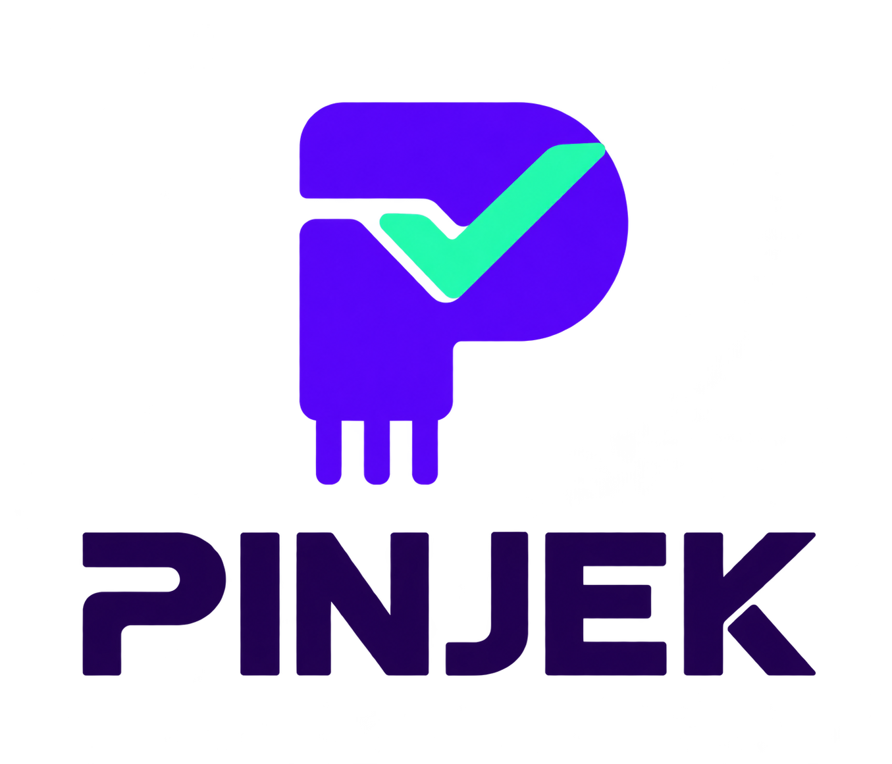

<p align="center">
  
</p>

<h3 align="center">Pinjam komponen teruji. Cek dulu, baru ganti.</h3>

<p align="center">
  Jaringan komponen pembanding bersama untuk bengkel elektronik. Prototipe MVP dengan data simulasi.
</p>


| Dasbor dampak | Katalog komponen |
| --- | --- |
|  |  |

| Rekomendasi pembanding | Evaluasi biaya & waktu |
| --- | --- |
|  |  |

## Menjalankan

Butuh Node.js 22.12+ dan npm.

```sh
npm ci
npm run dev
```

- Company profile: http://127.0.0.1:3000
- Aplikasi: http://127.0.0.1:3000/app
