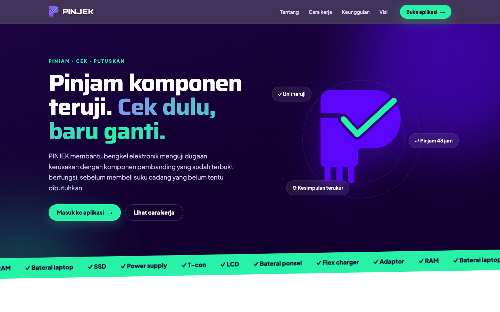
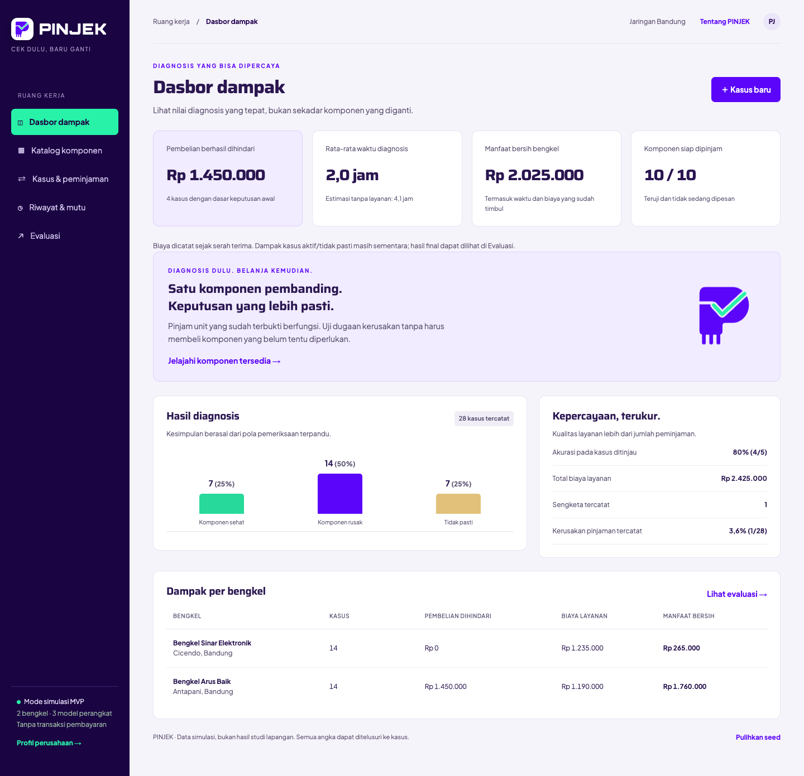
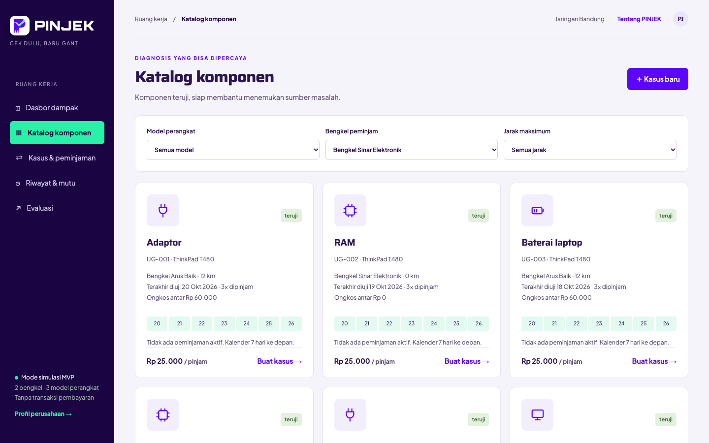
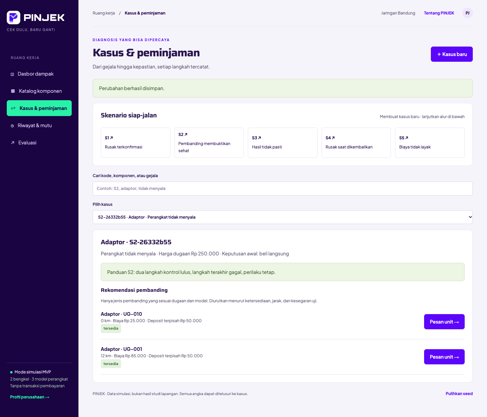
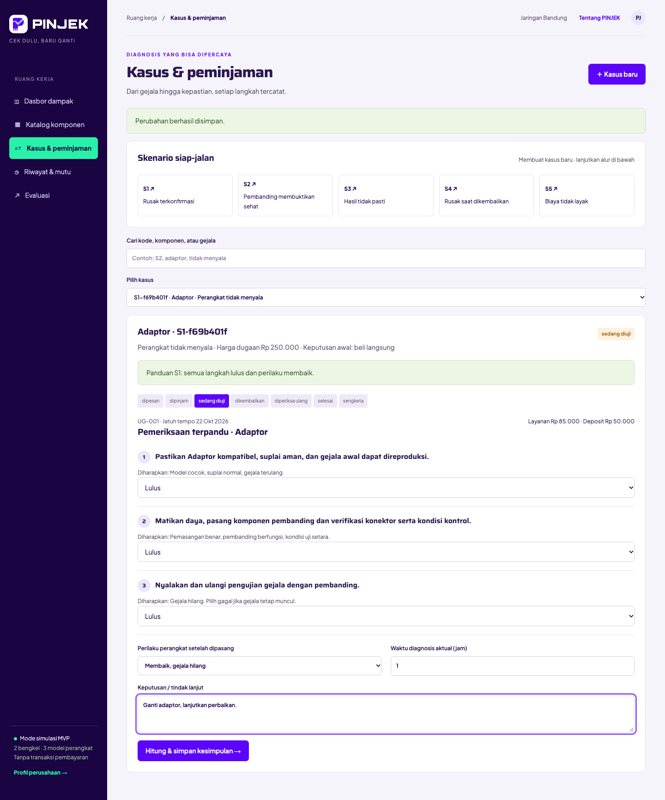
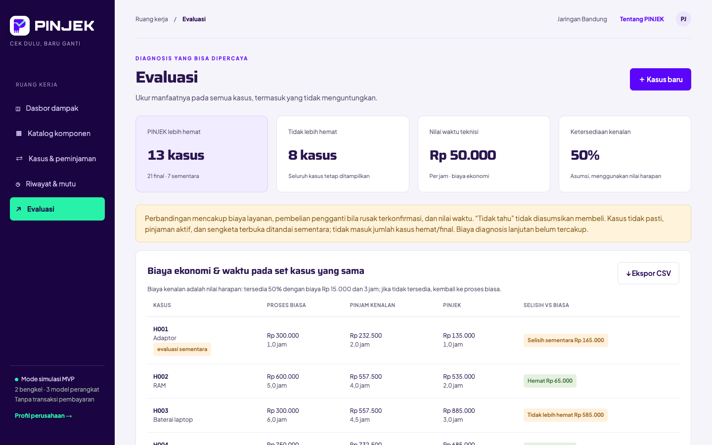
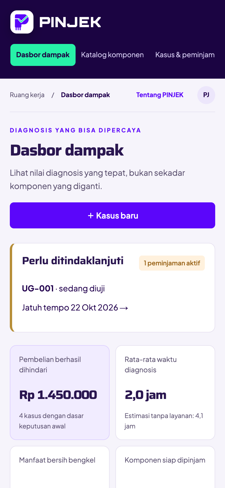
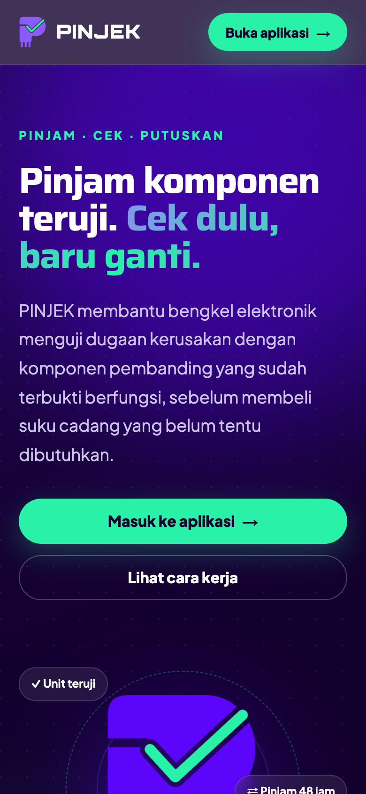

# PINJEK

MVP lokal jaringan komponen pembanding untuk bengkel elektronik: bengkel **meminjam komponen yang sudah teruji** untuk membuktikan dugaan kerusakan, sebelum membeli suku cadang yang belum tentu dibutuhkan. Bahasa Indonesia, Rupiah, 2 bengkel, 3 model perangkat, 10 unit komponen. Tanpa pembayaran, kurir, autentikasi, maupun data pelanggan akhir.

## Tampilan

Company profile di `/`, aplikasi di `/app`.



| Dasbor dampak | Katalog komponen |
| --- | --- |
|  |  |

**Rekomendasi pembanding** — hanya unit yang cocok dengan model dan dugaan, diurutkan menurut ketersediaan, jarak, dan kesegaran uji.



**Diagnosis terpandu** — tiga langkah prosedur menghasilkan kesimpulan sehat, rusak, atau tidak pasti beserta keyakinan.



**Evaluasi** — biaya dan waktu pada semua kasus, termasuk yang tidak lebih hemat.



**Tampilan HP**

| Dasbor | Company profile |
| --- | --- |
|  |  |

## Menjalankan

Prasyarat: Node.js 22.12+ dan npm. Pada pemasangan pertama jalankan `npm ci`. Setelah dependensi terpasang, aplikasi berjalan dengan satu perintah:

```sh
npm run dev
```

Buka http://127.0.0.1:3000 untuk company profile; aplikasi ada di http://127.0.0.1:3000/app. Server pengembangan mengikat loopback agar demo lokal tidak otomatis terbuka ke jaringan. Untuk pemeriksaan: `npm test`, `npm run typecheck`, dan `npm run test:e2e` (butuh Google Chrome). Mode produksi: `npm run build` lalu `npm start`.

## Struktur dan data

- `src/domain/types.ts`: bengkel, model, komponen, kasus, peminjaman, prosedur, hasil diagnosis, dan sengketa.
- `src/domain/config.ts`: seluruh parameter biaya, deposit, batas uji ulang, dan asumsi pembanding.
- `src/data/seed.ts`: 2 bengkel, 3 model, 10 unit, dan 28 kasus historis.
- `src/domain/engine.ts`: fungsi murni untuk transisi status, validasi pinjam, rekomendasi, kesimpulan, dampak, dan perbandingan.
- `src/domain/actions.ts`: penerapan perintah (pesan, serah terima, diagnosis, pengembalian, sengketa, koreksi).
- `src/domain/metrics.ts`: agregasi dampak, akurasi, dan ekspor CSV.
- `src/app/page.tsx`, `profil.css`, `reveal.tsx`: company profile beranimasi di `/`.
- `src/app/app/page.tsx`: aplikasi di `/app` (dasbor, katalog, kasus & peminjaman, riwayat & mutu, evaluasi).
- `src/components/`: `loan-flow.tsx` (bukti kondisi, pemeriksaan, pengembalian, sengketa), `logo.tsx`, dan `ui.tsx`.
- `src/data/store.ts`: antrean transaksi satu proses dan penulisan JSON atomik.
- `src/app/api/state/route.ts`: HTTP JSON dengan batas ukuran 64 KB, cek asal permintaan, dan kontrol revisi.
- `tests/*.test.ts` dan `tests/e2e`: pengujian domain, API, penyimpanan, dan alur browser desktop/ponsel.

Perubahan tersimpan di `data/ujiganti.json` (dibuat saat akses pertama, tidak disertakan dalam Git). Tombol **Pulihkan seed** di footer aplikasi menghapus perubahan setelah konfirmasi. Variabel lingkungan `UJIGANTI_DATA_DIR` mengarahkan penyimpanan ke direktori lain, terutama untuk pengujian. Layanan dirancang untuk satu proses lokal, bukan basis data multi-server.

## Cara menggunakan

1. Lihat Dasbor dampak dan Katalog komponen untuk status unit, jarak, dan ketersediaan tujuh hari.
2. Pada **Kasus & peminjaman**, jalankan skenario S1–S5 atau pilih **Kasus baru**. Catat keputusan awal tanpa layanan sebelum melihat hasil uji, dan jangan memasukkan data pelanggan.
3. Pilih pembanding dari rekomendasi lalu **Pesan unit**. Reservasi yang belum diserahkan dapat dibatalkan tanpa biaya.
4. Konfirmasi serah terima dengan tiga checklist yang lolos dan nama berkas foto, lalu jalankan pemeriksaan terpandu tiga langkah.
5. Catat pengembalian dengan bukti akhir. Pemilik membandingkan dua bukti dan melakukan uji ulang. Uji gagal atau kondisi memburuk membuka sengketa.
6. Di **Riwayat & mutu**, tinjau hasil nyata (sehat, rusak, atau tetap tidak pasti) dan catat sertifikasi ulang unit. Di **Evaluasi**, bandingkan biaya dan waktu lalu ekspor CSV.

## Mesin status dan kontrol mutu unit

```text
dipesan → dipinjam → sedang_diuji → dikembalikan → diperiksa_ulang → selesai
                                                              ↘ sengketa
```

Reservasi mengunci unit sejak dipesan dan server menolak reservasi ganda. Kalender adalah proyeksi peminjaman aktif selama tujuh hari, bukan pemesanan tanggal masa depan. Model dan jenis komponen harus cocok dengan dugaan kasus. Menguji jenis lain memerlukan kasus lanjutan agar kesimpulan tidak salah sasaran.

Setelah 8 pinjam sejak uji atau lebih dari 30 hari sejak uji, unit wajib diuji ulang. Pada 100 pinjam total, unit pensiun permanen. Status efektif dihitung saat tampil dan saat perintah diproses, tanpa cron. Unit dalam karantina `perlu_uji_ulang` tidak bisa dipinjam sampai uji fungsi ulang lulus dicatat.

## Aturan diagnosis

Tiga langkah prosedur: (1) kontrol kompatibilitas/suplai dan reproduksi gejala awal, (2) kontrol pemasangan dan fungsi pembanding, (3) uji apakah gejala hilang.

- Kedua kontrol lulus, langkah 3 lulus, perilaku membaik: **komponen dicurigai rusak**, keyakinan tinggi.
- Kedua kontrol lulus, langkah 3 gagal, perilaku tetap: **komponen dicurigai sehat**, keyakinan tinggi.
- Input tidak bisa dinilai, kontrol gagal, atau perubahan yang bertentangan: **tidak pasti**, keyakinan rendah, dengan saran kontrol tambahan.

Keputusan akhir dicatat terpisah. Hasil nyata yang berbeda dari kesimpulan menandai **diagnosis meleset** tanpa menimpa kesimpulan awal. Akurasi per prosedur = hasil cocok / kasus ditinjau dengan hasil nyata sehat atau rusak. Tinjauan yang masih tidak pasti tidak masuk penyebut.

## Ekonomi dan asumsi

- Biaya layanan = penggunaan Rp25.000 + ongkos antar Rp5.000/km + potongan deposit. Deposit tertahan bukan biaya. Biaya dicatat sejak serah terima.
- Deposit = 20% harga unit saat dipesan. Jarak adalah selisih posisi zona linear (0 dan 12 km), bukan rute GPS.
- Pembelian dihindari hanya jika keputusan awal beli langsung/coba ganti, kesimpulan sehat, dan tidak dikoreksi sebagai meleset. Tidak dihitung untuk rusak, tidak pasti, atau "tidak tahu".
- Manfaat bersih bengkel = pembelian dihindari + selisih waktu × Rp50.000/jam − biaya layanan.
- Jika penggunaan + antar melebihi harga dugaan, peringatan **layanan tidak layak** wajib diakui sebelum reservasi. Kelayakan ini hanya membandingkan biaya kas.
- Evaluasi memakai biaya ekonomi (kas + nilai waktu) pada set kasus yang sama. Pembanding "pinjam kenalan" memakai nilai harapan: 50% tersedia dengan biaya Rp15.000 dan 3 jam, sisanya kembali ke proses biasa. Parameter ini asumsi, bukan data empiris.
- Kasus tidak pasti, pinjaman aktif, dan sengketa terbuka ditandai **sementara** dan tidak masuk hitungan final. Semua baris tetap ditampilkan dan dapat diekspor ke CSV.

| Penyebab sengketa | Potongan peminjam |
| --- | --- |
| Rusak saat dipakai | 100% deposit |
| Rusak di perjalanan | 0% |
| Tidak jelas | 50% deposit |

Pemilik memilih penyebab berdasarkan perbandingan bukti, dan potongan tidak pernah melebihi deposit yang tersimpan.

## Skenario dan hasil seed

| Skenario | Yang diperagakan |
| --- | --- |
| S1 Rusak terkonfirmasi | Semua langkah lulus dan perilaku membaik, sehingga komponen dicurigai rusak. |
| S2 Pembanding membuktikan sehat | Dua kontrol lulus, langkah terakhir gagal, perilaku tetap: komponen dicurigai sehat. |
| S3 Hasil tidak pasti | Satu langkah dipilih "tidak bisa dinilai": kesimpulan tidak pasti, keyakinan rendah. |
| S4 Rusak saat dikembalikan | Diagnosis lulus, lalu uji ulang gagal dan membuka sengketa. |
| S5 Biaya tidak layak | Flex charger dari bengkel lain: biaya Rp85.000 melebihi harga Rp45.000, perlu pengakuan. |

Pada data seed (28 kasus historis), dasbor menampilkan pembelian dihindari Rp1.450.000, manfaat bersih Rp2.025.000, dan akurasi 80% (4 dari 5 kasus ditinjau). Evaluasi mencatat 13 kasus lebih hemat dan 8 tidak lebih hemat dari 21 kasus final; 7 kasus lainnya masih sementara. Angka ini berasal dari data simulasi, bukan hasil studi lapangan.

## Risiko dan validasi

1. **Heuristik simulasi, bukan pembuktian elektris.** Gangguan ganda, kompatibilitas parsial, atau kerusakan intermiten dapat menyesatkan. Prosedur per jenis komponen perlu dikembangkan dan disahkan teknisi sebelum pemakaian nyata. Matikan daya sebelum pertukaran unit.
2. **Evaluasi bukan klaim efektivitas.** Biaya modal, depresiasi inventaris, overhead operator, dan biaya diagnosis lanjutan belum masuk manfaat bersih.
3. **Parameter pembanding adalah asumsi.** Ketersediaan kenalan 50%, nilai jam teknisi Rp50.000, dan tarif antar perlu dikalibrasi dengan data lapangan.
4. **Tanpa transaksi nyata.** Tidak ada pembayaran, penagihan deposit, kurir, atau kontrak hukum. Foto simulasi hanya menyimpan nama berkas.
5. **Keterbatasan operasional.** Penyimpanan JSON satu proses, tanpa autentikasi, penguncian lintas proses, atau dukungan deployment publik. Gunakan hanya pada lingkungan tepercaya.

## Pemeriksaan yang telah dijalankan

- `npm test`: **53 test lulus** (aturan domain, skenario S1–S5, API, dan penyimpanan).
- `npm run typecheck`: lulus.
- `npm run build`: lulus (Next.js 15, rute `/` dan `/app` statis, `/api/state` dinamis).
- `npm run test:e2e`: **9 test browser lulus** pada Chrome, mencakup S1–S5 sampai pengembalian, pembatalan reservasi, penyaringan formulir, tampilan 390px, ekspor CSV, konflik revisi API, dan navigasi profil ↔ aplikasi.

---

© 2026 Vassel Goleyu. All rights reserved. Kode dan aset (termasuk nama dan logo PINJEK) tidak boleh digunakan, disalin, atau didistribusikan tanpa izin tertulis; lihat [LICENSE](LICENSE).
